&nbsp;

&nbsp;

&nbsp;

&nbsp;

&nbsp;

  <a href="https://www.volleyballoperatingsystem.com/vs-teamlinkt">Teamlinkt</a>
  &nbsp;·&nbsp;
  <a href="https://www.volleyballoperatingsystem.com/vs-teamsnap">TeamSnap</a>
  &nbsp;·&nbsp;
  <a href="https://www.volleyballoperatingsystem.com/vs-sportlomo">SportLoMo</a>
  &nbsp;·&nbsp;
  <a href="https://www.volleyballoperatingsystem.com/vs-iset">ISET</a>
  &nbsp;·&nbsp;
  <a href="https://www.volleyballoperatingsystem.com/vs-aes">AES</a>
  &nbsp;·&nbsp;
  <a href="https://www.volleyballoperatingsystem.com/vs-arbiter">Arbiter</a>
  &nbsp;·&nbsp;
  <a href="https://academy.volleyballoperatingsystem.com/p/privacy">Privacy</a>
  &nbsp;·&nbsp;
  <a href="https://academy.volleyballoperatingsystem.com/p/terms">Terms</a>

